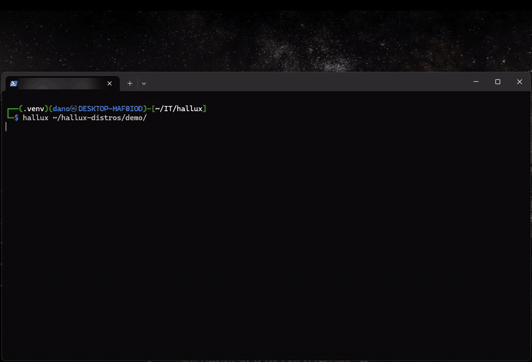

# Hallux

**A hallucinated Linux machine in your terminal.**


A Linux machine that exists only in an AI's imagination: you type real commands, Claude
imagines everything the machine prints, and a real folder on your computer is its disk.



*Booting a world, asking it for a coffee-themed prompt, then for a web app. Sped up while the
AI thinks.*

**[Tutorial](docs/guide/tutorial.md)** · **[How Hallux works](docs/guide/how-it-works.md)** ·
**[Addons](docs/guide/addons.md)** · **[Packages (hpm)](docs/hpm/tutorial.md)** ·
**[Development](docs/guide/development.md)**

## Get started

You need:

- **Python 3.11 or newer;**
- **Linux, or Windows through WSL;** macOS will likely work, but hasn't been tested;
- **access to Claude:** a logged-in [Claude Code](https://claude.com/claude-code) on the same
  computer, or an Anthropic API key in `ANTHROPIC_API_KEY`.

Install it, and power on a machine:

```bash
git clone https://github.com/danoo-C/hallux.git
cd hallux
python install.py                  # makes .venv and installs everything into it
python hallux.py ~/hallux-world    # power on; the folder is created if needed
```

The first boot invents a new machine, a minimal Debian 12 by default. Type commands as on
any Linux machine. To change the machine itself, talk to its maker:

```text
user@hallux:~$ hallux make my prompt green and bold
user@hallux:~$ hallux every error message should rhyme
```

### What a world is

**A world is a folder, and that folder is the machine's `/`.** Files the machine writes really
appear there; everything else (the kernel, the programs, their output) is imagined. Inside
it, `.hallux/` holds what the machine is: its memory, its settings (`config.toml`) and its log.
`reboot`, or starting Hallux again on the same folder, brings back the same machine.

- **Each world is its own machine.** Make as many as you like, copy them, give them away.
- **Use a dedicated folder.** The machine may change or delete anything inside it, and
  nothing outside. Hallux refuses your home folder.
- **`git init` in the world** makes every commit a snapshot of the whole machine.

### Two keys to know

| Keys | What they do |
|---|---|
| **Ctrl+F12** | Opens Hallux's own panel, over whatever is on screen |
| **Ctrl+Shift+Del**, or **Ctrl-C three times** within a second | Turns the machine off at once, whatever the AI is doing |

## The panel

Ctrl+F12 opens Hallux's own panel: over the shell, over a full-screen program, even while the
AI is answering. The machine never learns of it. Esc closes it. Each tab has a letter:

| Tab | What it is for |
|---|---|
| **Config** (`c`) | The model and the budgets, changed while the machine runs; Save writes them to `config.toml` |
| **Files** (`f`) | Files and folders you drag onto the terminal window, copied into the directory the shell is in |
| **Packages** (`g`) | Installing and updating apps from your [hpm](docs/hpm/tutorial.md) store, with checkboxes |
| **Agents** (`a`) and **Details** (`d`) | Background jobs of the addons, live, call by call; `k` kills one |


The [tutorial](docs/guide/tutorial.md#9-the-panel) has every setting, when a change takes
effect, and the Packages tab.

## Cost and safety

- **Every line you type is a call to a Claude model.** It takes a few seconds and costs
  tokens. The status bar at the bottom shows what the session has cost so far.
- **`max_budget_usd`** in the world's `config.toml`, or in the panel, caps what one boot may
  spend. A faster model, such as Sonnet or Haiku, is cheaper.
- **The machine can only touch its own folder.** The AI has no shell and no file access of
  its own, only Hallux's tools, and every path is jailed to the world.
- **What the machine reads is sent to Anthropic,** where the model runs. Don't put real
  secrets into a world. Passwords you type at a prompt are the exception: Hallux checks them
  itself, and the AI only learns whether they were right.

Addons run with your full rights: install only those you trust. More in
[How Hallux works](docs/guide/how-it-works.md#safety).

## Learn more

- **[Tutorial](docs/guide/tutorial.md):** your first hour, from the first boot to full-screen
  programs, dragging files in, the panel and every setting.
- **[How Hallux works](docs/guide/how-it-works.md):** the machine, its memory, how a command
  runs, full-screen programs, and the safety model.
- **[Addons](docs/guide/addons.md):** real hardware for the machine (a window, a sound card,
  web apps) and how to write your own.
- **[Packages: hpm](docs/hpm/tutorial.md):** move the apps you build from one world into
  another, yours or a friend's.
- **[Development](docs/guide/development.md):** the code, the tests, and how the project is
  worked on.

## License

MIT. See [LICENSE](LICENSE).
