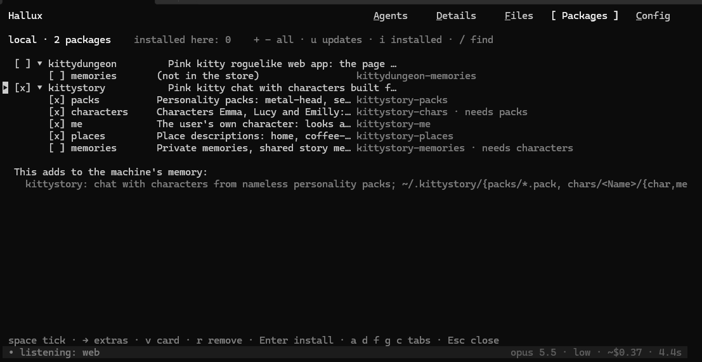
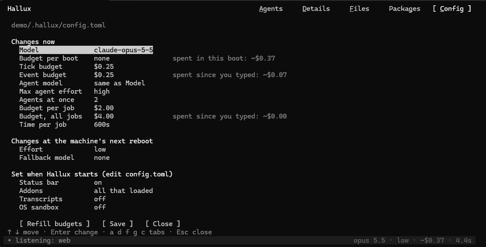

# Hallux tutorial

Your first hour with Hallux, in the order you'll need it. Start at the top and stop when you
have what you came for. How it all works underneath is in [How Hallux works](how-it-works.md).

[Back to the README](../../README.md)

---

## 1. Install

You need Python 3.11 or newer, Linux or Windows through WSL, and access to Claude: a
logged-in [Claude Code](https://claude.com/claude-code) on the same computer, or an Anthropic
API key in `ANTHROPIC_API_KEY`.

```bash
git clone https://github.com/danoo-C/hallux.git
cd hallux
python install.py
```

`install.py` makes a virtual environment in `.venv` and installs Hallux into it.
`hallux.py` switches into that environment by itself, so there's nothing to activate. Run
`python install.py --fresh` to build the environment again from nothing.

**A terminal that draws Unicode and 24-bit color** makes it look right: Windows Terminal,
GNOME Terminal, kitty, WezTerm, iTerm2.

## 2. The first boot

```bash
python hallux.py ~/hallux-world
```

The folder is created if needed, and it becomes the machine's `/`: its disk. The first boot
invents a new machine, a minimal Debian 12 by default, and writes down who it is. It takes a
little while; later boots are quicker.

```text
[    0.000000] Linux version 6.1.0-25-amd64 (debian-kernel@lists.debian.org) ...
[  OK  ] Reached target multi-user.target - Multi-User System.

Debian GNU/Linux 12 hallux tty1

user@hallux:~$
```

Every character there came from the AI: the boot log, the login, the prompt. From now on,
type as you would on any Linux machine.

- **The status bar** at the bottom belongs to Hallux, not to the machine: what the AI is
  doing, the model, what the session has cost so far, and how long the last answer took.
- **Ctrl-D at the prompt,** `exit` or `poweroff` turns the machine off.
  **Ctrl+Shift+Del**, or Ctrl-C three times within a second, turns it off at once, whatever
  the AI is doing.

> **Use a dedicated folder for each world.** The machine may change or delete anything
> inside it, and nothing outside it. Hallux refuses your home folder.

## 3. Real files, imagined programs

The disk is real; everything else is imagined, and stays consistent.

```text
user@hallux:~$ echo "print(sum(range(10)))" > sum.py      # sum.py really appears in the folder
user@hallux:~$ python3 sum.py                             # its run is imagined
45
user@hallux:~$ sudo apt install -y cowsay                 # an install is bookkeeping
user@hallux:~$ cowsay moo
```

| Kind of command | Examples | What happens |
|---|---|---|
| **Touches the disk** | `ls`, `cat`, `cd`, `echo >`, `mkdir`, `rm`, `mv`, `grep` | Read from and written to the real folder |
| **Runs a program** | `python3 sum.py`, `bash build.sh`, the `python3` prompt | The source is read from the disk, the run is imagined, and the files it writes are real |
| **Pure imagination** | `uname`, `ps`, `ping`, `apt install`, made-up commands | Invented, and consistent with what the machine remembers |

**The honest limit:** imagining isn't running. Short, ordinary scripts come out right.
Hashes (`sha256sum`), big numeric loops and exact floating point come out *plausible*, not
correct. There is no network: `pip install requests` works, but a request gets an imagined
answer.

## 4. Reshape the machine: the `hallux` command

`hallux <anything>` talks to the machine's maker instead of the machine. The change is made
at once, and it lasts.

```text
hallux make my prompt green and bold
hallux every error message should rhyme
hallux this machine actually runs Arch Linux
hallux install a text adventure called dungeon
hallux                                   # lists the active rules
hallux forget the rhyming thing
```

- **What bash can hold goes where bash keeps it:** a prompt or an alias goes into
  `~/.bashrc`.
- **Everything else becomes a rule** in the machine's memory, which it reads at every boot.
- **An invented program,** such as the text adventure above, gets a *program card* in
  `/usr/local/bin/`: a short text that says what the program is and how it behaves. The AI
  reads it each time you run the program. It is a plain file: read it, edit it, copy it.
- **The machine can't change its own hardware.** `hallux run on opus from now on` is
  declined: the model is set in `config.toml` (section 10), outside the machine.

## 5. Full-screen programs

`nano`, `vim`, `less`, `man`, `top` and games take the whole screen, as on a real machine.

- **Editors and pagers** (`nano notes.txt`, `less`, `man`): you type, move and scroll
  locally, with no model call per key. Only keys that do something, such as Ctrl-O to save
  or `q` to quit, go to the AI. A file you edit is read from the disk by Hallux and saved
  back exactly as you typed it.
- **Programs that react to every key** (`top`, `htop`, games, menus): every key and click
  goes to the AI, batched while it answers. `top` updates by itself every few seconds,
  within the budget `tick_budget_usd`.
- **Ctrl-Z puts a program aside,** with its screen and everything typed into it, and the
  shell is back. `fg` brings it back as it was, `jobs` lists what is put aside, and
  `kill %1` ends it.
- **The mouse works** in full-screen programs: a click goes to the program.

## 6. Passwords

At a password prompt (`sudo`, `passwd`, `ssh`) nothing you type is shown, and Hallux checks
the password itself against a salted hash in the world's `.hallux/passwords.json`. The AI
only learns whether it was right. A new machine has no password and accepts any; `passwd`
sets one.

## 7. Reboot, and what the machine remembers

`reboot`, or starting `hallux.py` again on the same folder, starts the machine from nothing
but its folder, like a real computer after a power cut.

| Survives (it's on the disk) | Forgotten (as on a real reboot) |
|---|---|
| Every file, `/etc/*`, `~/.bashrc` and `~/.bash_history` included | The current directory: you start at `~` |
| Who the machine is: OS, kernel, hardware, IP address | Variables and aliases typed at the prompt but not saved in `~/.bashrc` |
| Installed packages and invented programs | Running programs and programs put aside with Ctrl-Z |
| Every `hallux` rule | Invented details that were never written down |

**Snapshots:** run `git init` in the world folder. Each commit is then a snapshot of the
whole machine, and `git checkout` brings one back.

## 8. Dragging files into the machine

Press Ctrl+F12, then drag files or folders from your computer onto the terminal window. The
panel's Files tab shows what would be copied, as a tree with sizes, and where to: the
directory the shell is in. Enter copies it.

- **Nothing is overwritten unasked.** When a file exists already, Enter asks once: `o`
  overwrites, `s` skips. A folder that exists already is merged.
- **The copy runs by itself.** Close the panel and go on; `s` in the Files tab stops it, and
  what was copied stays.
- **The AI is told with your next line** where the files went, how many, and up to 20 of
  their names. Never their contents.
- **Terminals differ:** Windows Terminal pastes a drop, so it finds the Files tab from any
  tab. VS Code's terminal types it: open the Files tab first with `f`. `p` opens the path
  row for a path you type yourself.
- **It works on the computer the window is on.** A terminal sends a path, not the file, so
  a drop over ssh can't work, and neither can a picture dragged out of a browser. A Windows
  path (`C:\…`, `\\wsl$\…`) is translated.

## 9. The panel

Ctrl+F12 opens Hallux's own panel: at the shell, while the AI answers, and over a full-screen
program. The machine never learns of it. Esc or Ctrl+F12 closes it, and the screen is as it
was. Each tab has a letter.

| Tab | What it is for |
|---|---|
| **Agents** (`a`) | Every background job of the addons, and every agent that could start one. `k` kills a running job |
| **Details** (`d`) | What one job is doing, call by call, as it happens |
| **Files** (`f`) | The files you drag onto the window (section 8) |
| **Packages** (`g`) | Installing, updating and removing apps from your [hpm](../hpm/tutorial.md) store, with checkboxes, into the running machine |
| **Config** (`c`) | Every setting, with what was spent beside each budget |



*The Packages tab: an app from the store, with its extras as checkboxes. Space ticks, → shows
the extras, Enter installs into the running machine.*



*The Config tab, in three groups: what changes at once, at the machine's next reboot, and
only when Hallux starts.*

**In the Config tab,** a change lasts for this run, and **Save** writes it into the world's
`config.toml`: only the lines you changed, your comments and every other line left as they
are. **Refill budgets** starts the counting of every budget anew, without raising a limit.

| Setting | A change takes effect |
|---|---|
| `model`, `max_budget_usd`, `tick_budget_usd`, `event_budget_usd` | At once. A new model answers the next line |
| The six `agent_…` settings | With the next job. The panel shows them on a machine that has an addon with an agent |
| `effort`, `fallback_model` | At the machine's next `reboot` |
| `status_bar`, `addons`, `keep_transcripts`, `os_sandbox` | When Hallux starts: edit `config.toml` |

## 10. Settings

Each world reads its settings from `<world>/.hallux/config.toml` when Hallux starts. Every
setting is optional, and command-line flags win over the file. The machine can't see or
change this file.

```toml
# Every setting is optional. Defaults: Opus 5.5 at low effort, no budget cap, status bar on.
model = "claude-opus-5-5"        # which Claude model runs the machine
effort = "low"                   # low, medium, high, xhigh, max
fallback_model = "claude-haiku-4-5"
max_budget_usd = 2.0             # a boot holds its messages back after spending this much
status_bar = true                # the bottom status row
tick_budget_usd = 0.25           # live updates in raw mode, per program run
event_budget_usd = 0.25          # addon events, since the last line you typed
addons = ["window"]              # the addons this machine gets; left out: all that loaded
keep_transcripts = false         # let Claude Code also keep its own session transcript
os_sandbox = false               # run Claude Code under bubblewrap

# The addons' agents and their background jobs. The numbers are the defaults.
agent_model = "claude-opus-5-5"  # the model of every job; left out: the one the machine runs on
agent_max_effort = "high"        # an agent gets the effort it asks for, or this if it asks for more
agent_max_running = 2            # jobs at the same time, over all addons; 0 turns the agents off
agent_job_budget_usd = 2.0       # what one job may cost; a job that uses it up is killed
agent_budget_usd = 4.0           # all jobs together, since you last typed a line or pressed a key
agent_timeout_seconds = 600      # how long one job may run
```

- **A boot that has used up `max_budget_usd` sends nothing more to the AI.** The line you
  typed comes back at the prompt, and the bar says `budget used`. Raise the budget or refill
  it in the panel, or press Ctrl-D to power off.
- **The first answer after a model switch costs more, once:** the new model reads the whole
  conversation of the boot at the full price.
- **`agent_budget_usd` is filled again when you do something:** a typed line, or a key in a
  full-screen program. It stops jobs that start each other while nobody is at the keyboard.
- **Jobs count towards `max_budget_usd`, each when it has ended,** so a boot can pass its
  cap by what its running jobs spend: at most `agent_budget_usd`.
- **`os_sandbox = true`** runs Claude Code under [bubblewrap](https://github.com/containers/bubblewrap)
  (`bwrap`, which you install yourself): the filesystem read-only, your home folder hidden
  except Claude Code's login, and a private `/tmp`.

## 11. Cost and speed

Every line you type, even an empty Enter, is a call to a Claude model: a few seconds, and
some tokens.

- **A faster model** (Sonnet, Haiku) or a lower effort is quicker and cheaper.
- **`max_budget_usd`** caps a boot. The panel raises or refills it while the machine runs.
- **Full-screen programs send only the rows that change,** and editors cost a call per
  action key, not per key.
- **Give a world only the addons it uses** (`addons = [...]`). Each addon adds its tools to
  every request, and each event it reports to a listening machine is a call of its own.
- **The `~` in `~$1.42`** says the cost is what the tokens would cost at the API's list
  prices. With a Claude subscription nobody is billed that amount.
- **A background job is a session of its own,** with its own cost: the Agents tab shows it,
  and the bar's total has it once the job has ended.

## 12. Addons and packages

- **[Addons](addons.md)** give the machine real hardware: a window on your desktop, a sound
  card, web apps in a window of their own. The machine gets every addon that loads unless
  its `config.toml` names some with `addons = [...]`.
- **[hpm](../hpm/tutorial.md)** moves the apps you built in one world into any other, yours
  or a friend's: `hpm publish` in one world, `hpm install` in another, from your terminal or
  the panel's Packages tab.

## 13. The command line

```bash
python hallux.py ~/hallux-world                         # power on
python hallux.py ~/hallux-world --model claude-sonnet-5-5 --effort medium
python hallux.py ~/hallux-world --script commands.txt   # type the lines of a file, without a screen
python hallux.py ~/new-world --check reboot             # build a machine and check it survives a reboot
```

`--model` and `--effort` win over `config.toml` for that run. `--script -` reads the lines
from standard input.

## 14. When something goes wrong

- **The log:** every message to the AI and back, each tool call and each cost is in
  `<world>/.hallux/hallux.log`.
- **The AI seems stuck:** the status bar says what it is doing. Ctrl-C reaches the machine
  as on a real one; Ctrl+Shift+Del turns it off.
- **`budget used` on the bar:** the boot spent `max_budget_usd`. Raise it or refill it in
  the panel (section 9).
- **An addon doesn't load:** the machine starts without it, the status bar shows a note, and
  the reason is in the log. Usually its Python package is missing: see [Addons](addons.md).
- **The machine got something wrong:** tell it, as you would tell a person, or reshape it
  with `hallux`. `hallux forget …` takes a rule back.
